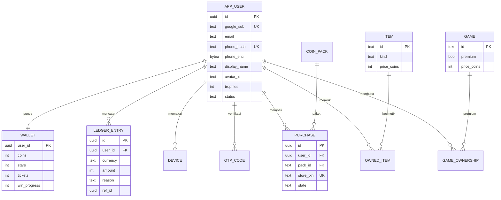
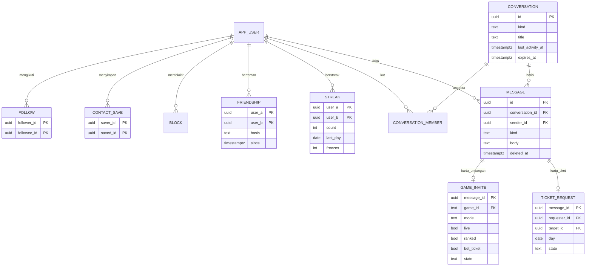
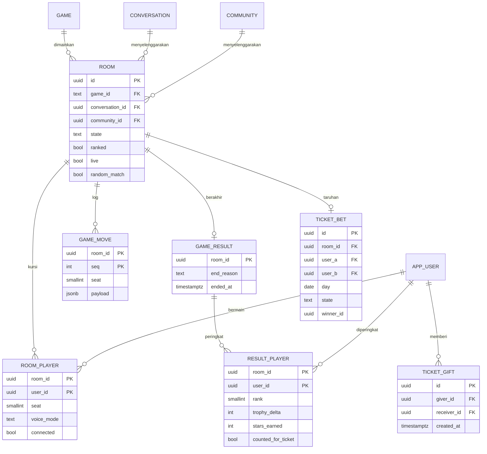
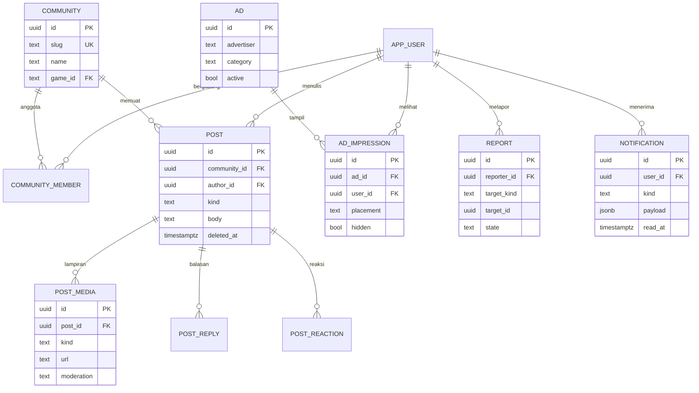

# Gmers: ERD dan Skema Data

Basis data: PostgreSQL 16. Semua kunci utama `uuid` (v7, urut waktu). Waktu `timestamptz` (UTC). Uang dalam Rupiah bulat (`integer`), Koin, Bintang, Tiket, dan Trofi selalu bilangan bulat. Skema SQL lengkap ada di `docs/schema.sql` dan menjadi sumber kebenaran; diagram ini untuk dibaca manusia.

## Prinsip desain

1. **Buku besar (ledger) untuk semua mata uang.** Saldo Koin, Bintang, Tiket, dan Trofi tidak disimpan sebagai angka yang diubah sembarangan. Setiap perubahan adalah baris di `ledger_entry` (hanya ditambah, tidak pernah diubah). Saldo di `wallet` adalah salinan yang diperbarui dalam transaksi yang sama dengan baris ledger.
2. **Tiga mata uang tidak boleh berpindah.** Ada batasan data: `ledger_entry.currency` dan `reason` dibatasi daftar, dan tidak ada alasan yang menukar Koin ke Tiket atau Rupiah ke Tiket.
3. **Pertemanan bukan tabel yang diisi manual.** Dihitung dari `follow` dan `contact_save`, dan disimpan sebagai `friendship` (turunan) agar kueri cepat dan bisa diaudit.
4. **Game disimpan sebagai log langkah** (`game_move`) agar bisa diputar ulang, divalidasi ulang, dan dipakai deteksi curang.
5. **Konten dan pesan** memakai penghapusan lunak (`deleted_at`), kecuali room sekali pakai yang dihapus permanen oleh penyapu terjadwal.

## Diagram

Empat diagram per domain. File sumber ada di `docs/erd/*.mmd` dan hasil render di `docs/erd/*.svg`. Entitas `APP_USER` muncul di beberapa diagram supaya hubungan terbaca; tabelnya satu. Hanya kolom penting yang ditampilkan; daftar penuh ada di `schema.sql`.

### 1. Akun dan keuangan

### 2. Hubungan sosial dan chat

### 3. Game dan Tiket

### 4. Komunitas, iklan, dan keselamatan

## Kamus tabel

### Akun dan keuangan
| Tabel | Isi | Aturan penting |
|---|---|---|
| `app_user` | Akun. Login Google (`google_sub`), nomor HP (hash untuk pencocokan, terenkripsi untuk kirim OTP), avatar, nama, trofi, status (siap, sibuk, senyap, dnd). | Satu `phone_hash` untuk satu akun (unik). Kelas tidak disimpan; dihitung dari trofi. |
| `otp_code` | Kode verifikasi (hash), percobaan, kedaluwarsa. | Kedaluwarsa 5 menit, maksimal 5 percobaan. |
| `device` | Token push dan sidik perangkat. | Dipakai deteksi akun ganda. |
| `wallet` | Saldo Koin, Bintang, Tiket, dan progres menang menuju Tiket. | Hanya diubah lewat fungsi yang menulis `ledger_entry`. Ada CHECK saldo >= 0. |
| `ledger_entry` | Buku besar mata uang (Koin, Bintang, Tiket). Trofi dicatat di `result_player`. | Hanya INSERT. `reason` dari daftar tetap; tidak ada alasan lintas mata uang. |
| `coin_pack`, `purchase` | Paket Koin dan pembelian dari toko aplikasi, dengan token transaksi. | Token transaksi unik (cegah pembelian ganda). |
| `item`, `owned_item` | Katalog kosmetik (avatar, emoji, skin) dan kepemilikan. | Harga dalam Koin. |
| `game_ownership` | Game premium yang dimiliki pengguna. | Pemilik room membeli; tamu main gratis (dicek lewat room). |

### Hubungan sosial
| Tabel | Isi | Aturan penting |
|---|---|---|
| `follow` | A mengikuti B. | Tidak boleh mengikuti diri sendiri. |
| `contact_save` | A menyimpan kontak B. | Pencocokan lewat nomor HP atau pilihan manual. |
| `friendship` | Turunan: pasangan (a<b) dan dasar (`follow` atau `contact`). | Dibuat/dihapus oleh fungsi `recompute_friendship(a,b)` setiap `follow` atau `contact_save` berubah. |
| `block` | Pemblokiran. | Memutus pertemanan. |
| `streak` | Pasangan teman, hitungan, tanggal terakhir, pembeku tersimpan. | Pasangan terurut (a<b). |

### Chat
| Tabel | Isi | Aturan penting |
|---|---|---|
| `conversation` | Jenis `direct`, `group`, atau `room`. `expires_at` hanya untuk `room`. | Room dihapus penyapu bila `now() > expires_at`. `expires_at` digeser 24 jam saat ada aktivitas. |
| `conversation_member` | Anggota dan pesan terakhir yang dibaca. | `direct` selalu tepat 2 anggota dan keduanya berteman saat dibuat. |
| `message` | Isi pesan. `kind`: teks, emoji, undangan, tiket, sistem. | |
| `game_invite` | Detail kartu undangan: game, mode, kapan, ranked, taruhan, status. | |
| `ticket_request` | Permintaan Tiket antar teman. | Satu per peminta, target, dan hari (UNIQUE). |

### Game
| Tabel | Isi | Aturan penting |
|---|---|---|
| `game` | Katalog: Ludo, Gaple, dan lainnya. Aktif atau tidak, premium atau tidak. | |
| `room` | Sesi bermain. `state`: menunggu, berjalan, selesai, dibatalkan. Bisa terkait `conversation` atau `community`. | |
| `room_player` | Kursi, mode (suara, chat, senyap), status koneksi. | Maksimal 4 per room. |
| `game_move` | Log langkah berurutan (`seq`). | Hanya INSERT. UNIQUE (`room_id`, `seq`). |
| `game_result`, `result_player` | Hasil, peringkat, perubahan trofi, penanda apakah kemenangan dihitung ke Tiket. | `counted_for_ticket` false untuk lawan yang sama pada hari itu atau game pasif. |
| `ticket_bet` | Taruhan 1 Tiket 1-1 dengan escrow. | Satu per pasangan per hari (UNIQUE pada pasangan dan tanggal). |
| `ticket_gift` | Pemberian Tiket. | Batas 10 per minggu dihitung dari baris ini. |

### Komunitas dan iklan
| Tabel | Isi |
|---|---|
| `community`, `community_member` | Komunitas (misal Gaple Bandung) dan anggotanya. Room komunitas memakai `room.community_id`. |
| `post`, `post_media`, `post_reply`, `post_reaction` | Postingan (kind: biasa atau perkenalan), media (foto, video), balasan utas, dan suka atau simpan. |
| `ad`, `ad_impression` | Iklan native dan catatan tampil, untuk pelaporan dan pembatasan frekuensi. |

### Keselamatan
`report` (pelapor, sasaran, alasan, status) dan `notification` (jenis, payload, terbaca).

## Aturan integritas yang harus dijaga basis data

1. `wallet` tidak pernah negatif.
2. `ledger_entry` tidak bisa diubah atau dihapus (pemicu menolak UPDATE dan DELETE).
3. `app_user.phone_hash` unik.
4. `game_move (room_id, seq)` unik.
5. `ticket_request (requester_id, target_id, day)` unik.
6. `ticket_bet (least(user_a,user_b), greatest(user_a,user_b), day)` unik.
7. `conversation.kind='direct'` memiliki tepat 2 anggota.
8. `friendship.user_a < friendship.user_b`.

## Penghitungan yang dilakukan di kode, bukan disimpan

- Kelas dari trofi (tabel kelas ada di konfigurasi).
- Sisa waktu room (`expires_at - now()`).
- Batas memberi Tiket mingguan (jumlah `ticket_gift` 7 hari terakhir).
- Daftar "Menunggu saling" (ada `follow` atau `contact_save` tanpa `friendship`).
